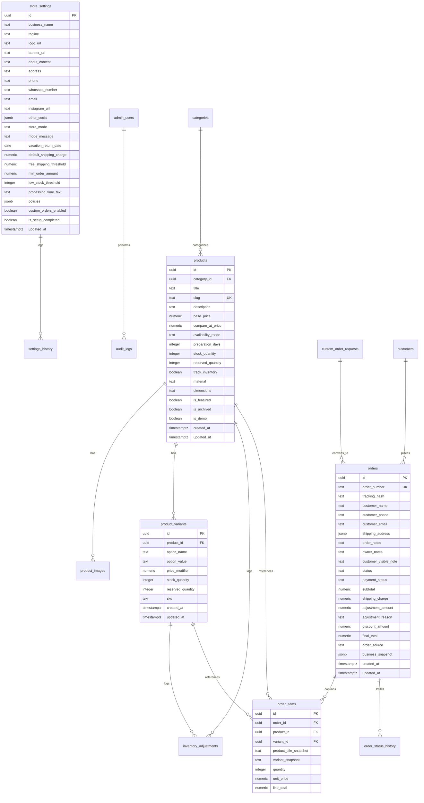

# Database Design & Schema Documentation: Vedanya Craft Ghar

## 1. Schema Overview

The database is built on **Supabase PostgreSQL 17**. All tables employ UUID primary keys (using `gen_random_uuid()`), strict NOT NULL constraints, sensible CHECK constraints, foreign key referential integrity with appropriate ON DELETE actions, and automatic `updated_at` triggers.

---

## 2. Entity Relationship Diagram (ERD)

---

## 3. Data Tables & Column Details

### 3.1 `admin_users`
Manages authorized owner and staff profiles linked to Supabase `auth.users`.
- `id` (UUID, PK) -> references `auth.users(id)` ON DELETE CASCADE
- `email` (TEXT, NOT NULL, UNIQUE)
- `full_name` (TEXT)
- `role` (TEXT, NOT NULL CHECK (`role IN ('OWNER', 'STAFF')`))
- `created_at`, `updated_at` (TIMESTAMPTZ)

### 3.2 `store_settings`
Single-row configuration enforcing zero-hardcoded business info.
- Single-row enforced via `CONSTRAINT single_row_check CHECK (id = '00000000-0000-0000-0000-000000000001'::uuid)`.
- `store_mode` ENUM/CHECK: `'OPEN'`, `'TEMPORARILY_CLOSED'`, `'VACATION'`, `'CUSTOM_ORDERS_ONLY'`, `'MAINTENANCE'`.
- Default shipping rules: `default_shipping_charge`, `free_shipping_threshold`, `min_order_amount`.
- Policies stored as structured JSONB: `{ return_policy, shipping_policy, privacy_policy, terms_conditions }`.
- `is_setup_completed` (BOOLEAN DEFAULT FALSE).

### 3.3 `settings_history`
Audit log of all configuration adjustments made by administrators.
- `id` (UUID, PK), `changed_by` (UUID FK admin_users), `diff` (JSONB), `created_at`.

### 3.4 `categories`
- `id` (UUID, PK), `name` (TEXT, NOT NULL), `slug` (TEXT, UNIQUE), `description` (TEXT), `display_order` (INT), `is_hidden` (BOOL), `is_demo` (BOOL).

### 3.5 `products` & `product_variants`
- `availability_mode`: `'READY_TO_SHIP'`, `'MADE_TO_ORDER'`, `'PRE_ORDER'`, `'OUT_OF_STOCK'`, `'HIDDEN'`.
- Available stock is calculated as: `(stock_quantity - reserved_quantity)`.
- `is_demo` (BOOL): Allows 1-click purge of initial sample artisan items.

### 3.6 `orders` & `order_items`
- `order_number`: Generated atomically from sequence `order_number_seq` (e.g., `VCG-2026-1001`).
- `status`: `'PENDING_APPROVAL'`, `'CONFIRMED'`, `'PREPARING'`, `'READY_TO_SHIP'`, `'SHIPPED'`, `'DELIVERED'`, `'REJECTED'`, `'CANCELLED'`.
- `payment_status`: `'UNPAID'`, `'PAID'`, `'REFUNDED'`.
- `business_snapshot`: Stores frozen store name, phone, address, and policy snippets at time of order creation.

### 3.7 `order_status_history`
- Logs all transitions with `old_status`, `new_status`, `changed_by` (admin UUID or 'CUSTOMER' / 'SYSTEM'), and `note`.

### 3.8 `custom_order_requests`
- `status`: `'NEW'`, `'QUOTED'`, `'ACCEPTED'`, `'DECLINED'`, `'CONVERTED'`.
- Private reference image path in Supabase Storage.

### 3.9 `inventory_adjustments`
- Logs reasons: `'ORDER_APPROVED_RESERVED'`, `'ORDER_REJECTED_RELEASED'`, `'ORDER_FULFILLED_DEDUCTED'`, `'MANUAL_COUNT'`, `'RESTOCK'`.

### 3.10 `notifications`
- In-app admin alert queue with `is_read` boolean flag.

---

## 4. Key Database Functions (RPC)

1. **`create_order_rpc`**:
   - Accepts order payload, customer details, and item list.
   - Validates that store mode allows ordering.
   - Generates next order number from `order_number_seq`.
   - Freezes current `store_settings` snapshot into `business_snapshot`.
   - Inserts `orders` and `order_items`.
   - Creates a new notification entry.
   - Returns created order details and tracking hash.

2. **`approve_order_rpc`**:
   - Takes `order_id` and `admin_id`.
   - Checks that order is in `PENDING_APPROVAL`.
   - Locks target products and variants using `FOR UPDATE`.
   - Verifies sufficient available stock for each tracked item.
   - Increments `reserved_quantity` on products/variants.
   - Logs adjustment to `inventory_adjustments`.
   - Updates status to `CONFIRMED`.
   - Records transition in `order_status_history`.

3. **`reject_order_rpc`**:
   - Takes `order_id`, `admin_id`, and `reason`.
   - Updates status to `REJECTED`, records reason and status history.

4. **`fulfill_order_rpc`**:
   - On transition to `SHIPPED` or `DELIVERED`, converts reserved quantities into permanent stock deductions (`stock_quantity = stock_quantity - reserved_quantity`, `reserved_quantity = reserved_quantity - requested_quantity`).

