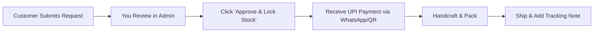

# Owner Handover & Everyday Operating Guide: Vedanya Craft Ghar 🌸

*Welcome to your very own handmade boutique platform! This guide was written especially for you, designed to be completely non-technical, simple, and empowering. You have 100% control over your store—no developer needed!*

---

## 1. How to Log In to Your Owner Platform

1. In your web browser, go to your website address followed by `/admin`:
   `https://your-domain.com/admin` (or `http://localhost:3000/admin` locally).
2. Enter your credentials:
   - **Username / Email:** `jigishaowner@2026` *(or `artisan@vedanyacraft.in`)*
   - **Password:** `jigishaowner@2026` *(or `VedanyaOwner2026!`)*
   - Or simply click **"Enter Owner Console as Authenticated Store Owner"** to jump straight in with 1 click!

---

## 2. Understanding Your Daily Routine

Your e-commerce platform uses an **artisan-first two-stage order pipeline**. Here is how everyday orders work:

1. **A Customer places an order:**
   - They pick their crochet or handmade items and enter their delivery address.
   - At checkout, they receive a **Provisional Order Request** (with a clean A4 PDF). Stock is **NOT** charged or deducted yet—this protects you from fake or unverified orders!
   - The customer clicks **"Send Order to Owner on WhatsApp"**, sending you a friendly pre-written message with their order number.

2. **You review the order (`/admin/orders`):**
   - Click on the pending order.
   - You can review what they want, check your physical yarn/materials, and if needed, add a small delivery adjustment or festival discount.
   - Click **"Approve & Lock Stock"**. The system instantly reserves the physical items so they cannot be sold to anyone else!

3. **Payment via UPI / QR:**
   - Share your Google Pay / PhonePe QR code with the customer on WhatsApp.
   - Once they transfer the amount, click **"Mark as Paid"** in the order screen.

4. **Dispatch & Tracking:**
   - When you finish handcrafting and packing, click **"Mark as Shipped"** and paste the courier tracking number (e.g. India Post or DTDC tracking number).
   - The customer can visit `/track-order` anytime on your website, type their order number and phone number, and see the exact progress bar!

---

## 3. Logging Sales from Instagram DMs, WhatsApp, or Exhibitions

Do you sell items directly through Instagram direct messages or pop-up craft stalls? You can log them so your stock numbers and customer history stay accurate:

1. In your Owner Platform, click **Orders** → **"Log Manual Sale"** (`/admin/orders/new`).
2. Select whether it was from **Instagram DM**, **WhatsApp**, or **Exhibition/In-Person**.
3. Type the customer's name, phone number, and address.
4. Select the item from your catalog (or type a custom craft name) and quantity.
5. Click **"Save & Confirm Manual Order"**.
6. Done! The order is recorded, stock is adjusted, and the customer is added to your permanent Customer Directory.

---

## 4. Taking a Break or Going on Vacation? 1-Click Store Modes! 🏖️

As a teacher and handmade artisan, your time is precious. If exams are coming up or you are going on a family trip, you don't need to take down your website:

1. Go to **Settings** (`/admin/settings`).
2. Under **"1-Click Operating Mode Switcher"**, click one of the buttons:
   - **OPEN:** Everything active, normal ordering.
   - **TEMPORARILY CLOSED:** Pauses new orders and displays a polite banner at the top of your shop. Visitors can still browse your beautiful creations.
   - **VACATION:** Enter the date you will return (e.g., Nov 20). A special banner announces: *"We are on vacation until Nov 20! Orders will reopen then."*
   - **CUSTOM ORDERS ONLY:** Hides the instant ready-stock cart and invites visitors to submit custom craft enquiry requests for future dates.
   - **MAINTENANCE:** Displays a work-in-progress message while you organize new collections.
3. Your storefront updates instantly across all devices!

---

## 5. Adding New Products & Managing Stock

### Adding a New Creation:
1. Go to **Products** → **"Add New Product"** (`/admin/products/new`).
2. Enter the title (e.g. *Pastel Daisy Crochet Scrunchie*).
3. Pick the category (Scrunchies, Crochet, etc.).
4. Enter the price (e.g. ₹249).
5. Add photo links.
6. Check the **Live Storefront Card Preview** on the right side of the screen! You can see exactly how customers will see it before saving!
7. Click **"Save Product"**.

### Quick Inventory Adjustment:
1. Go to **Inventory** (`/admin/inventory`).
2. Find the item you just made more of.
3. Click **"Adjust"**, enter the new physical count, and type a reason like *"Made 5 more over the weekend"*.
4. Click **"Confirm Adjustment"**.

---

## 6. Purging Demo Data Before Public Launch

When you are ready to remove the sample crochet bear and scrunchie demo items that came with the template:
1. Go to **Products** (`/admin/products`).
2. You will see a red button at the top: **"Purge Demo Data"**.
3. Click it and confirm. All sample demo data will be permanently wiped with one click, leaving your catalog clean and ready for your own creations!

---

## 7. Customer Directory & Exporting for Festivals

1. Visit **Customers** (`/admin/customers`).
2. Here you will see every person who has ordered from you, sorted by how much they love your crafts (Lifetime Spend).
3. Click the green **WhatsApp** button next to any customer to send them a greeting or festival discount!
4. Click **"Export CSV"** anytime to download a spreadsheet of your customers. The export is fully protected against spreadsheet formula injections.

---

*Wishing you tremendous joy and success with Vedanya Craft Ghar!* ✨

